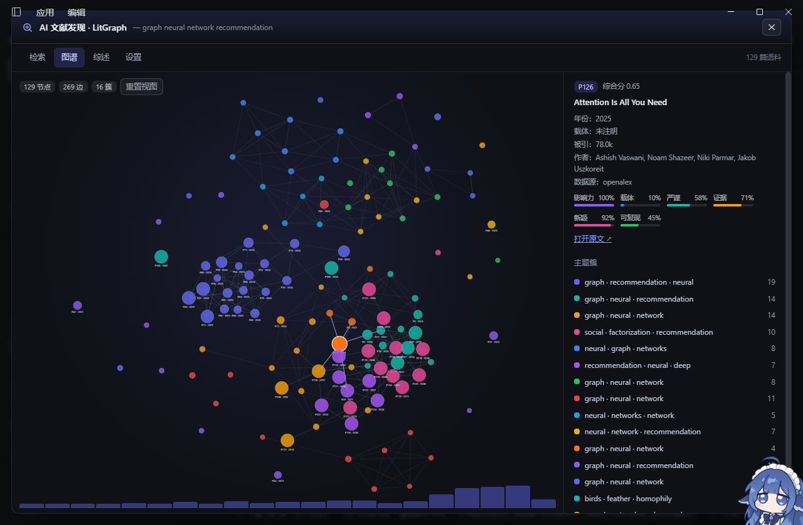
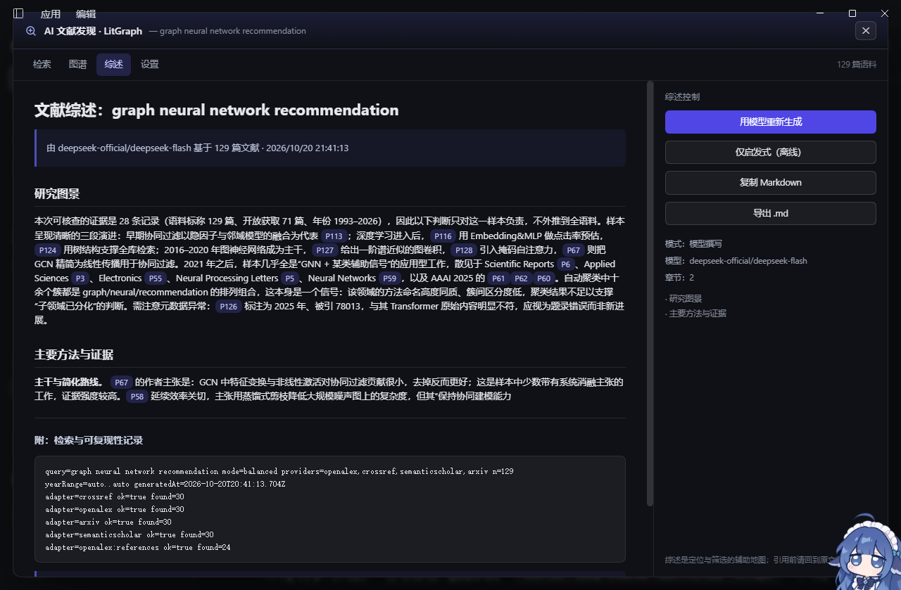

# dsh-litgraph — AI 文献发现与综述

> 给 [DeepSeek Harness](https://github.com/deepseek-ai) 的文献调研插件：**跨源检索 → 知识图谱 → 六维评估 → 结构化综述 → 按工作区归档**。
> 侧边栏一个入口，人和 Agent 共用同一套能力：你点出来的图谱，Agent 也能用工具拿到；Agent 写下的综述，你在面板里能直接读。



<p align="center"><em>检索 <code>graph neural network recommendation</code>：129 篇文献、269 条边、16 个主题簇，右侧是六维评分与主题簇图例，底部是年度分布。</em></p>

---

## 它解决什么问题

做文献调研时真正耗时的不是"搜到论文"，而是：

1. 四五个数据库各搜一遍，结果还要手工去重；
2. 搜到 100 篇之后，看不出**谁和谁是一伙的**、哪条脉络才是主线；
3. 判断"这篇值不值得读"全靠直觉，没有可比较的维度；
4. 读完一堆，写综述时又要把笔记重新组织一遍；
5. 下次再调研同一主题，上次的成果散落在聊天记录和临时文件里。

这个插件把上面五步串成一条流水线，并且**把结果落成工作区里的文件**，而不是锁在插件状态里。

## 特性

- **四源并行检索**：OpenAlex / Crossref / Semantic Scholar / arXiv，按 DOI + 归一化标题去重，合并各家最完整的字段。
- **引文滚雪球**：命中靠前的论文会顺着参考文献与相关文献再捞一层，补上关键词搜不到的经典工作。
- **六维质量评分**：影响力、载体、严谨、证据、新颖、可复现，加权后与检索相关度混合排序，避免"高被引但离题"压住切题新作。
- **知识图谱**：引用、主题、术语、同作者四类边 + 标签传播聚类，主题簇带中文图例；节点坐标由标题哈希决定，**同一批论文在任何窗口尺寸下位置不变**。
- **AI 撰写综述**：走宿主内置 `llm` 服务，十节结构（检索方法 / 语料概览 / 研究脉络 / 主题簇 / 方法对比 / 六维评估 / 共识与争议 / 研究空白 / 阅读路径 / 可复现附录）；模型不可用时自动回退到确定性模板，离线也能出稿。
- **按工作区归档**：每份综述落在 `<工作区>/.literature-review/NNN-标题/`，含 `meta.json`、`review.md`、`papers.json`、`graph.json`；一个工作区可以有多份，切换工作区互不干扰。
- **Agent 原生**：7 个工具，Agent 一句话就能"调研 + 写综述 + 落盘"，并会先检查已有档案、询问新建还是覆盖。

## 工作原理

```
检索 ──▶ OpenAlex / Crossref / Semantic Scholar / arXiv（并行）
   │
   ├─ DOI + 标题归一化去重，字段取最全
   ├─ 引文滚雪球（参考文献 + 相关文献）
   │
排序 ──▶ 六维质量分 × 检索相关度（0.82 / 0.18）+ 被引微量加成
   │
图谱 ──▶ 引用边 / 主题边 / 术语边 / 同作者边 → 标签传播聚类 → 年度分布
   │
综述 ──▶ 宿主 llm 撰写（不可用则确定性合成）
   │
归档 ──▶ <工作区>/.literature-review/NNN-标题/{meta,review,papers,graph}.json|md
```

## 安装

### 方式一：从本仓库装（推荐）

```bash
# 把插件装进 desktop profile
dsh plugin --profile desktop add github:boypu123/litgraph-literature-review

# 在 profile 补丁层登记这个插件（补丁条目必须用 insert 形式）
# ~/.dsh/profiles/desktop/cordis.patch.yml
```

```yaml
- insert:
    - id: litgraph
      name: 'dsh-litgraph'
```

重启 DeepSeek Harness，侧边栏底部会出现 **文献发现**。

### 方式二：手工复制

```powershell
$src = "<本仓库路径>"
$dst = "$env:USERPROFILE\.dsh\profiles\desktop\node_modules\dsh-litgraph"
New-Item -ItemType Directory -Force -Path $dst | Out-Null
Copy-Item "$src\lib" -Destination $dst -Recurse -Force
Copy-Item "$src\package.json","$src\cordis.patch.yml" -Destination $dst -Force
```

> `~/.dsh` 在会话工作区之外，普通沙箱进程写入会被拒（`FS_SANDBOX_DENIED`），部署这一步需要提权执行一次。

## 使用

### 面板

1. 侧边栏点 **文献发现**（或 `Esc` 关闭）。
2. **检索**：输入主题，回车即搜。可选数据源、年份区间、每源条数、是否滚雪球。
3. **图谱**：节点按主题簇着色，点节点看详情（年份 / 载体 / 被引 / 作者 / 六维评分 / 原文链接），底部是年度分布。
4. **综述**：`用模型重新生成` 写出综述正文，`仅启发式（离线）` 不依赖模型，`复制 Markdown` / `导出 .md` 带走。
5. **综述 → 文献综述档案**：选工作区（下拉里就是侧边栏的工作区）→ `新建` 或 `保存`；`刷新` 重新扫一遍目录。选中档案点 `读取`，会连 `papers.json` / `graph.json` 一起载回——**检索列表与图谱同步恢复成该档案的语料**，不必重新检索。
6. **设置**：数据源开关、综述模型、polite pool 邮箱、默认落盘工作区。



### 对话里让 Agent 用

> "帮我调研 retrieval augmented generation 的评测方法，写一份综述，存到档案里。"

Agent 会先 `litgraph_archives` 看这个工作区有没有旧档案（有就问你是新建还是覆盖），再 `litgraph_archive_save` 一次完成检索 + 撰写 + 落盘，最后把 `review.md` 的内容或路径回给你。

| 工具 | 作用 |
| --- | --- |
| `litgraph_search` | 跨源检索 + 去重 + 六维评分排序，返回题录与摘要片段 |
| `litgraph_map` | 知识图谱：节点 / 边 / 主题簇 / 年度分布 / 图指标 |
| `litgraph_review` | 结构化文献综述（Markdown），模型不可用时自动回退 |
| `litgraph_archives` | 列出当前工作区 `.literature-review/` 下的所有档案 |
| `litgraph_archive_create` | 新建一份空档案（拿到 id 后可分步填充） |
| `litgraph_archive_save` | 检索 + 撰写 + 写入 `NNN-标题/`，一次调用出成品 |
| `litgraph_archive_read` | 读回某份档案的 `review.md`（支持 `maxChars` 截断） |

## 工作区档案

综述不锁在插件状态里，而是按工作区落盘，任何 Agent、编辑器或 `git` 都能读：

```text
<工作区>/.literature-review/
├── index.json                     # 档案索引：id / 标题 / 篇数 / 更新时间
├── 001-图神经网络推荐系统/
│   ├── meta.json                  # 检索参数、统计、时间戳
│   ├── review.md                  # 综述正文（Markdown）
│   ├── papers.json                # 题录快照（去重后）
│   └── graph.json                 # 节点 / 边 / 主题簇 / 年度分布
└── 002-rag-评测/
    └── ...
```

- 目录名 = `NNN-<标题>`，编号按创建顺序递增，中文标题直接保留。
- 一个工作区可以有多份综述；同一 `archiveId` 再次保存即覆盖更新（`updatedAt` 刷新）。
- 工作区根目录解析顺序：工具参数 `workspace` → 配置 `workspace` → 宿主已知的第一个工作区 → 进程目录；所有写入都做越界校验，只能落在 `<工作区>/.literature-review/` 内。
- 面板的**工作区下拉**来自宿主工作区注册表（就是侧边栏那几个），切换即读该工作区的档案；**刷新**重新扫描目录，外部手工新建的档案也能读到。
- 客户端只能订阅"工作区列表快照"，拿不到"当前正在浏览哪个工作区"的接口，所以切换侧边栏工作区后面板不会自动跳转——点一次刷新即可。

## 六维评估

| 维度 | 依据 | 权重 |
| --- | --- | --- |
| 影响力 impact | 年均被引（相对语料最高值） | 0.22 |
| 载体 venue | 顶刊/顶会名单、DOI、类型 | 0.16 |
| 严谨 rigor | 统计与实验信号词密度、摘要完整度 | 0.20 |
| 证据 evidence | 结果陈述密度、摘要深度 | 0.16 |
| 新颖 novelty | 时效、新颖措辞、预印本 | 0.15 |
| 可复现 reproducibility | 开放获取、代码/数据声明 | 0.11 |

分数用于**排序与筛选**，不是对研究质量的终审；`relevance`（检索引擎位次）另以 0.18 权重进最终排名。

## 配置

写入 `~/.dsh/litgraph.json`，也可在 GUI「设置」页改：

```json
{
  "providers": ["openalex", "crossref", "semanticscholar", "arxiv"],
  "yearFrom": null,
  "yearTo": null,
  "language": "zh",
  "mailto": "",
  "workspace": "C:\\path\\to\\your\\workspace",
  "llm": {
    "enabled": true,
    "provider": "deepseek-official",
    "model": "deepseek-flash",
    "maxTokens": 3000,
    "temperature": 0.3
  }
}
```

`mailto` 填邮箱可加入 OpenAlex / Crossref polite pool，配额更稳。综述走宿主内置 `llm` 服务，不需要额外密钥。

## HTTP 接口

仅回环可用（`/api/dsh-litgraph/*`，非回环请求一律 403）：

| 方法 | 路径 | 说明 |
| --- | --- | --- |
| GET | `/status` | 版本、数据源、配置、可用 llm provider、工作区根与档案根 |
| GET | `/workspaces` | 宿主工作区注册表（id / 路径 / 标题）与当前解析出的工作区根 |
| POST | `/config` | 局部更新配置（合并写盘；可改 `workspace`） |
| POST | `/search` | 检索 → papers + graph + stats + log |
| POST | `/review` | 检索 → 综述（`useLlm:false` 强制离线合成） |
| GET | `/archives` | 列出工作区内所有综述档案（可带 `?workspace=`） |
| POST | `/archives/create` | 新建空档案 |
| POST | `/archives/save` | 检索 + 撰写 + 落盘（可覆盖同 id） |
| POST | `/archives/read` | 读回 `review.md`（`maxChars` 截断） |
| POST | `/archives/delete` | 删除档案目录（仅限 `.literature-review/` 内） |

## 项目结构

```text
dsh-litgraph/
├── package.json          # dsh.bundle.patch + dsh.client，宿主/浏览器双入口
├── cordis.patch.yml      # 插件登记条目（insert 形式）
├── lib/
│   ├── index.js          # 宿主：检索适配器、评分、图谱、综述、HTTP 路由、7 个工具
│   └── client.js         # 浏览器：面板（检索/图谱/综述/设置）+ 侧边栏入口，无构建步骤
├── check.mjs             # 语法与导出自检
├── smoke.mjs             # 离线冒烟：假 ctx 跑通路由与工具
└── docs/                 # 截图
```

## 实现要点

- **零运行时依赖**：宿主侧只用 Node 内置模块与 `fetch`；浏览器侧只 `require("react")`，避免 profile 内的模块解析问题。
- **降级优先**：任一数据源失败只记进 `log` 并继续；Semantic Scholar 匿名限流（429）自动重试后放弃，不影响整体；模型不可用回退启发式综述。
- **可复现**：评分为确定性函数，综述附录打印 query / mode / providers / 各适配器耗时与错误。
- **图谱布局确定**：节点坐标由标题哈希种子 + 固定迭代次数得到，不随窗口尺寸漂移。
- **档案即文件**：`.literature-review/` 是唯一事实来源，每次操作都重新扫描目录，外部改动也能看到。
- **工具返回值必须是 lossless JSON**：宿主会校验工具返回值，含 `undefined` / `NaN` / `Infinity` 会被判 `INVALID_TOOL_OUTPUT`。插件统一用 `lossless()` 递归清理后再返回。

## 已知边界

- 只覆盖开放元数据接口，未接入 Web of Science / Scopus 与灰色文献。
- 排序依据题录与摘要，可能与全文结论有偏差；被引计数受学科与年份强烈影响（例如 OpenAlex 会把某些经典论文归到新版本上）。
- 综述是"定位与筛选的地图"，引用前请回到原文核对。

## 开发

```bash
# 语法与导出自检（不需要装依赖）
node check.mjs

# 离线冒烟：用假 ctx 跑通路由与工具，产出 smoke-result.txt / smoke-review.md
node smoke.mjs

# 离线渲染面板：用极简 React shim 执行组件，排查“点了没反应”这类渲染崩溃
node dev/render-probe.mjs   # 结果写 dev/render-probe.txt
```

**改宿主代码后怎么让它生效。** 宿主的 HMR 只监听 profile 补丁层（启动日志里是 `watching []`），`node_modules` 内的文件改动**不会**触发重载。要让改动生效，把补丁里这个条目的任一配置值改一下（组合变化会让 loader 带新时间戳重新 import）：

```yaml
- insert:
    - id: litgraph
      name: 'dsh-litgraph'
      config:
        cacheMinutes: 90   # 改任意值即可触发重新导入
```

浏览器侧 `lib/client.js` 刷新页面即可；桌面端不吃 `Ctrl+R` / `F5` 的话，重启应用最省事。

## License

MIT
